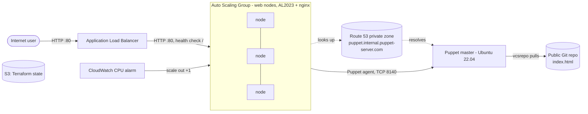

# Architecture

## What this project is

An AWS web hosting stack defined entirely in Terraform. Traffic enters through an Application Load Balancer and is served by an Auto Scaling Group of nginx web nodes. A dedicated Puppet master configures those nodes and deploys the website from a Git repository.

## System overview



## Folder structure

```
.
├── main.tf                 # Wires the modules together
├── provider.tf             # S3 backend + AWS provider
├── variables.tf            # Root inputs
├── outputs.tf              # Root outputs
├── terraform_example_tfvars# Template for terraform.tfvars (git-ignored)
├── run_tests.sh            # Runs every unit test suite
├── tests/                  # Root wiring test
├── docs/                   # This documentation
└── modules/aws/
    ├── module_aws_security_groups/   # ALB + web security groups
    ├── module_aws_ec2_puppet_master/ # Puppet server instance, its SG, bootstrap script
    ├── module_aws_dns/               # Private Route 53 zone + record for the master
    ├── module_aws_launch_template/   # Web node template + bootstrap script
    ├── module_aws_alb/               # Load balancer, target group, listener
    └── module_aws_asg/               # Auto Scaling Group, scale-out policy, CPU alarm
```

Each module has `main.tf`, `variables.tf`, `outputs.tf`, `versions.tf` and a `tests/` folder, and refers to nothing outside its own folder, so it can move to its own repository. The two bootstrap scripts are `.tftpl` templates.

## Data and control flow

1. **Terraform apply** creates security groups, the Puppet master, the DNS record pointing at the master's private IP, the launch template, ALB and ASG, in dependency order.
2. **Puppet master boots** (user data): installs Puppet Server, sets its certname and DNS names to the internal FQDN, installs an autosign script that accepts any CSR carrying the shared secret, installs the `vcsrepo` module, and writes the `profile::website` class and `site.pp`.
3. **Web nodes boot** (user data): install and start nginx (serving its default page for now), install the Puppet agent, write the shared secret into `csr_attributes.yaml`, set `certname` to the EC2 instance ID, and write the site repo URL and branch as Puppet *facts* (`/etc/puppetlabs/facter/facts.d/site.txt`).
4. **First Puppet run**: the agent contacts the master over port 8140, its certificate request is auto-signed, and the master's catalog (nodes named `i-xxxx...`) clones the repo, copies `index.html` and assets into the nginx web root, and keeps nginx running.
5. **Steady state**: agents re-check in every 30 minutes, so pushing to the Git branch updates all nodes with no Terraform run.
6. **Scaling**: a CloudWatch alarm (average CPU above `cpu_threshold` for 2 x 120 s) triggers a +1 instance policy with a 300 s cooldown. The ASG health check uses the ALB, with a 180 s grace period.

## Why it works this way (design decisions)

| Decision | Reason |
|---|---|
| **Terraform for infrastructure, Puppet for configuration** | Each tool does what it is best at. Terraform makes cloud resources reproducibly; Puppet continuously enforces what runs *inside* servers. Content changes do not require touching infrastructure. |
| **Reusable modules, one per concern** | Small, testable units with explicit inputs/outputs; root `main.tf` reads as a table of contents. |
| **ASG + ALB with ELB health checks** | Nodes are disposable. Unhealthy ones are replaced automatically and traffic only reaches healthy ones. |
| **`$Latest` template version, rolling instance refresh (50% min healthy)** | New instances always use the newest template. A refresh replaces running nodes without downtime, but it must be started by hand: `$Latest` does not trigger it (see [KNOWN_ISSUES.md](KNOWN_ISSUES.md), issue 2). |
| **Private Route 53 zone with a stable FQDN for the master** | Nodes find the master by name, not IP, so the master can be replaced without editing node configuration. |
| **Autosign with a shared secret in the CSR** | ASG nodes appear and disappear unpredictably; manual certificate signing would not scale. The secret restricts autosign to nodes launched from this template. |
| **Instance ID as Puppet certname** | Unique per node and available at boot, so replaced nodes never clash with old certificates. |
| **Site repo/branch passed as Puppet facts** | Keeps a single source of truth in `terraform.tfvars`; Puppet code stays generic. |
| **S3 remote backend** | Shared, durable state instead of a local file. |
| **Security groups reference each other** | Web nodes accept HTTP only from the ALB; the master accepts 8140 only from web nodes. SSH is limited to the EC2 Instance Connect range. |
| **`ignore_changes = [user_data, ami]` on the master** | Prevents a bootstrap script edit or a newly published Ubuntu image from destroying and rebuilding the Puppet server (and its CA). |
| **`ignore_changes = [desired_capacity]` on the ASG** | The scaling policy owns the running node count. Without this, every apply would reset the fleet to `asg_desired_capacity` and undo scale-out. |
| **Sensitive variable for the autosign secret** | Keeps it out of plan output. |

## Security notes

- `*.tfvars`, state files and keys are git-ignored. State in S3 contains the autosign secret in plain text, so restrict and encrypt that bucket.
- The secret is also present in instance user data. Anyone with `ec2:DescribeInstanceAttribute` or instance access can read it; rotate it if exposed.
- The master and the web nodes require IMDSv2 (`http_tokens = "required"`, hop limit 1). A plain GET to the metadata service, as an SSRF bug would send, cannot read user data or credentials. Any process on the instance can still get a token, so this does not protect against code already running there.
- Traffic is unencrypted HTTP. Add an HTTPS listener with an ACM certificate before real use.

## Limits and trade-offs

Single Puppet master (no HA); scale-out only; HTTP only; the website must be a public repo; the fixed internal domain `internal.puppet-server.com` is set in `main.tf` and the DNS module; unit tests exist but there is no CI (see [TESTING.md](TESTING.md), [DEPLOYMENT.md](DEPLOYMENT.md)). The full list of problems is in [KNOWN_ISSUES.md](KNOWN_ISSUES.md).
