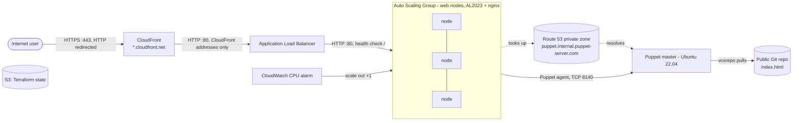

# Architecture

## What this project is

An AWS web hosting stack defined entirely in Terraform. Visitors connect over HTTPS to a CloudFront distribution, which forwards to an Application Load Balancer; the site is served by an Auto Scaling Group of nginx web nodes. A dedicated Puppet master configures those nodes and deploys the website from a Git repository.

## System overview



## Folder structure

```
.
├── main.tf                 # Wires the modules together
├── bootstrap/              # Admin-applied once: autosign secret (SSM), instance roles, PassRole for terraform-user
├── provider.tf             # S3 backend + AWS provider
├── variables.tf            # Root inputs
├── outputs.tf              # Root outputs
├── terraform_example_tfvars# Template for terraform.tfvars (git-ignored)
├── run_tests.sh            # Runs every unit test suite
├── tests/                  # Root wiring test
├── docs/                   # This documentation
└── modules/aws/
    ├── module_aws_security_groups/   # ALB + web security groups
    ├── module_aws_ec2_puppet_master/ # Puppet server instance, its SG, bootstrap script
    ├── module_aws_dns/               # Private Route 53 zone + record for the master
    ├── module_aws_launch_template/   # Web node template + bootstrap script
    ├── module_aws_alb/               # Load balancer, target group, listener
    ├── module_aws_cloudfront/        # CloudFront distribution (HTTPS for visitors), cache policy
    └── module_aws_asg/               # Auto Scaling Group, scale-out policy, CPU alarm
```

Each module has `main.tf`, `variables.tf`, `outputs.tf`, `versions.tf` and a `tests/` folder, and refers to nothing outside its own folder, so it can move to its own repository. The two bootstrap scripts are `.tftpl` templates.

## Data and control flow

1. **Terraform apply** creates security groups, the Puppet master, the DNS record pointing at the master's private IP, the launch template, ALB and ASG, in dependency order.
2. **Puppet master boots** (user data): installs Puppet Server, sets its certname and DNS names to the internal FQDN, checks that its instance role can read the autosign secret in SSM Parameter Store, installs an autosign script that reads the secret from SSM for each request and accepts only CSRs carrying it, installs the `vcsrepo` module, and writes the `profile::website` class and `site.pp`.
3. **Web nodes boot** (user data): install nginx without starting it, install the Puppet agent, read the autosign secret from SSM Parameter Store through their instance role and write it into `csr_attributes.yaml` (deleted again after the first Puppet run), set `certname` to the EC2 instance ID, and write the site repo URL and branch as Puppet *facts* (`/etc/puppetlabs/facter/facts.d/site.txt`).
4. **First Puppet run**: the agent contacts the master over port 8140, its certificate request is auto-signed, and the master's catalog (nodes named `i-xxxx...`) clones the repo, copies `index.html` and assets into the nginx web root, and only then starts nginx. Until this run succeeds the node answers nothing, so it fails the health check and gets no traffic. The node retries the first run for up to 4 minutes (the master may still be installing on a fresh deploy); if it never succeeds, the node stays unhealthy and the ASG replaces it.
5. **Steady state**: agents re-check in every 30 minutes, so pushing to the Git branch updates all nodes with no Terraform run.
6. **Scaling**: a CloudWatch alarm (average CPU above `cpu_threshold` for 2 x 120 s) triggers a +1 instance policy with a 300 s cooldown. The ASG health check uses the ALB, with a 600 s grace period, which covers boot plus the first Puppet run.

## Why it works this way (design decisions)

| Decision | Reason |
|---|---|
| **Terraform for infrastructure, Puppet for configuration** | Each tool does what it is best at. Terraform makes cloud resources reproducibly; Puppet continuously enforces what runs *inside* servers. Content changes do not require touching infrastructure. |
| **Reusable modules, one per concern** | Small, testable units with explicit inputs/outputs; root `main.tf` reads as a table of contents. |
| **ASG + ALB with ELB health checks** | Nodes are disposable. Unhealthy ones are replaced automatically and traffic only reaches healthy ones. |
| **nginx started only by Puppet, after the site files** | A node passes the health check only once it serves the real site. It never serves the default nginx page, and a node whose setup failed is replaced instead of staying "healthy". The cost is a 600 s grace period, which an instance refresh also waits for each batch. |
| **Explicit template version, rolling instance refresh (50% min healthy)** | The ASG uses the launch template's `latest_version` number, not `$Latest`. When the template changes, the number changes, Terraform updates the ASG, and a rolling refresh replaces running nodes without downtime. Because the template always looks up the newest Amazon Linux 2023 image, a new image release also starts a refresh on the next apply. |
| **Private Route 53 zone with a stable FQDN for the master** | Nodes find the master by name, not IP, so the master can be replaced without editing node configuration. |
| **Autosign with a shared secret in the CSR** | ASG nodes appear and disappear unpredictably; manual certificate signing would not scale. The secret restricts autosign to nodes launched from this template. |
| **Instance ID as Puppet certname** | Unique per node and available at boot, so replaced nodes never clash with old certificates. |
| **Site repo/branch passed as Puppet facts** | Keeps a single source of truth in `terraform.tfvars`; Puppet code stays generic. |
| **S3 remote backend** | Shared, durable state instead of a local file. |
| **CloudFront for HTTPS, without a custom domain** | Gives visitors HTTPS with CloudFront's own certificate, which needs no domain. The ALB's security group accepts traffic only from CloudFront's managed prefix list. That list is shared by every CloudFront distribution, so the stack's own distribution also adds a secret `X-Origin-Verify` header, and the ALB answers 403 to any request without it. The HTTPS address is therefore the only way in. Pages are cached for 5 minutes, so Puppet's site updates appear within minutes. |
| **Security groups reference each other** | Web nodes accept HTTP only from the ALB; the master accepts 8140 only from web nodes. SSH is limited to EC2 Instance Connect, using the region's AWS-managed prefix list. |
| **`ignore_changes = [user_data, ami]` on the master** | Prevents a bootstrap script edit or a newly published Ubuntu image from destroying and rebuilding the Puppet server (and its CA). |
| **`ignore_changes = [desired_capacity]` on the ASG** | The scaling policy owns the running node count. Without this, every apply would reset the fleet to `asg_desired_capacity` and undo scale-out. |
| **Autosign secret in SSM, created by an admin-applied `bootstrap/` config** | Terraform generates the secret as an ephemeral value and writes it write-only (`value_wo`), so it is never in a plan, the state, tfvars or user data. The instances read it at boot through roles whose only permission is `ssm:GetParameter` on that parameter. The roles are created by an administrator, so `terraform-user` never gets to create IAM roles: it may only pass these two roles to EC2. |

## Security notes

- `*.tfvars`, state files and keys are git-ignored. Both state backends write with server-side encryption (`encrypt = true`) and lock the state during runs (`use_lockfile = true`, a `.tflock` object next to the state), so two applies cannot overwrite each other. Restrict access to the state bucket.
- The autosign secret is stored only in the encrypted SSM parameter, and briefly on each node until its first Puppet run. The master never stores it; `autosign.sh` reads it for each request. A process running on a node can still read it through the node's role; checking that each request comes from a real ASG instance is in [TODO.md](TODO.md). Rotate it with `autosign_secret_version` in `bootstrap/`.
- The master and the web nodes require IMDSv2 (`http_tokens = "required"`, hop limit 1). A plain GET to the metadata service, as an SSRF bug would send, cannot read user data or credentials. Any process on the instance can still get a token, so this does not protect against code already running there.
- The root volumes of the master (which holds the Puppet CA key) and the web nodes are encrypted explicitly with the AWS-managed EBS key, whatever the account's default.
- Visitors use HTTPS (CloudFront redirects HTTP). The ALB forwards only requests that carry the secret origin header, so another CloudFront distribution pointed at the ALB gets 403. The header value is generated by Terraform (`random_password.origin_header` in `main.tf`) and is stored in the encrypted state and in the CloudFront and listener rule settings. The hop from CloudFront to the ALB is still plain HTTP, so the header crosses the network unencrypted (see [KNOWN_ISSUES.md](KNOWN_ISSUES.md), issue 22).

## Limits and trade-offs

Single Puppet master (no HA); scale-out only; HTTPS only on a generated `*.cloudfront.net` address; the website must be a public repo; the fixed internal domain `internal.puppet-server.com` is set in `main.tf` and the DNS module; unit tests exist but there is no CI (see [TESTING.md](TESTING.md), [DEPLOYMENT.md](DEPLOYMENT.md)). The full list of problems is in [KNOWN_ISSUES.md](KNOWN_ISSUES.md).
