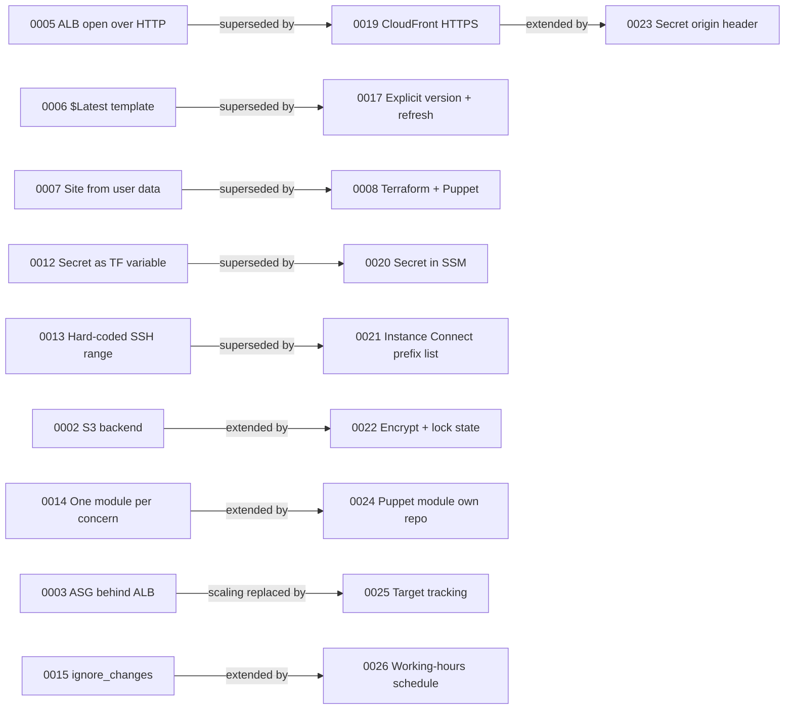

# Decision log

Architecture Decision Records (ADRs) for this stack. Each record follows Michael Nygard's template (Title, Status, Context, Decision, Consequences), with a date, considered options and good/bad consequences added from [MADR](https://adr.github.io/madr/). Why we keep them is in [0001](0001-record-architecture-decisions.md).

## Log

| # | Decision | Status | Date | Context | Superseded by |
|---|---|---|---|---|---|
| [0001](0001-record-architecture-decisions.md) | Record architecture decisions as ADRs | Accepted | 2026-11-20 | Reasons lived in one table that showed only the current state | — |
| [0002](0002-s3-remote-backend.md) | Store Terraform state in an S3 remote backend | Accepted | 2026-10-05 | Local state is not durable or shared | — (extended by [0022](0022-encrypt-and-lock-state.md)) |
| [0003](0003-asg-behind-alb.md) | Web nodes in an ASG behind an ALB with ELB health checks | Accepted | 2026-10-17 | Fixed instances were not replaced on failure | — (scaling replaced by [0025](0025-target-tracking-scaling.md)) |
| [0004](0004-security-groups-reference-each-other.md) | Security groups reference each other | Accepted | 2026-10-17 | Instance IPs change on replacement | — |
| [0005](0005-alb-open-to-internet-over-http.md) | ALB open to the internet over HTTP | **Superseded** | 2026-10-17 | First public entry point, no domain | [0019](0019-cloudfront-for-https.md) |
| [0006](0006-asg-follows-latest-template.md) | ASG uses the `$Latest` template version | **Superseded** | 2026-10-16 | Default way to point an ASG at a template | [0017](0017-explicit-template-version-rolling-refresh.md) |
| [0007](0007-serve-site-from-user-data.md) | Deploy the website from EC2 user data | **Superseded** | 2026-10-18 | Each node must serve the site | [0008](0008-terraform-infrastructure-puppet-configuration.md) |
| [0008](0008-terraform-infrastructure-puppet-configuration.md) | Terraform for infrastructure, Puppet for configuration | Accepted | 2026-10-19 | Running nodes never picked up site changes | — |
| [0009](0009-private-dns-for-puppet-master.md) | Private Route 53 name for the Puppet master | Accepted | 2026-10-19 | Master's IP changes when it is replaced | — |
| [0010](0010-instance-id-as-certname.md) | Instance ID as Puppet certname | Accepted | 2026-10-19 | Replaced nodes must not clash with old certificates | — |
| [0011](0011-autosign-with-shared-secret.md) | Autosign CSRs that carry a shared secret | Accepted | 2026-10-19 | ASG nodes appear at any time; manual signing does not scale | — |
| [0012](0012-autosign-secret-as-terraform-variable.md) | Autosign secret as a sensitive Terraform variable | **Superseded** | 2026-10-19 | Secret must reach master and nodes | [0020](0020-autosign-secret-in-ssm-via-bootstrap.md) |
| [0013](0013-ssh-from-hard-coded-instance-connect-range.md) | SSH from a hard-coded Instance Connect range | **Superseded** | 2026-10-17 | SSH for debugging without opening port 22 widely | [0021](0021-ssh-through-instance-connect-prefix-list.md) |
| [0014](0014-one-module-per-concern.md) | One reusable module per concern | Accepted | 2026-10-20 | Flat root files had implicit interfaces and no tests | — (extended by [0024](0024-puppet-server-module-own-repository.md)) |
| [0015](0015-lifecycle-ignore-changes.md) | `ignore_changes` on the master and the ASG | Accepted | 2026-10-19 | Applies rebuilt the master and undid scale-out | — (extended by [0026](0026-working-hours-schedule.md)) |
| [0016](0016-imdsv2-and-encrypted-root-volumes.md) | Require IMDSv2, encrypt root volumes | Accepted | 2026-11-11 | IMDSv1 open to SSRF; encryption left to account defaults | — |
| [0017](0017-explicit-template-version-rolling-refresh.md) | Explicit template version and rolling refresh | Accepted | 2026-11-16 | Template changes did not reach running nodes | — |
| [0018](0018-nginx-started-only-by-puppet.md) | nginx started only by Puppet | Accepted | 2026-11-16 | Nodes served the default page and stayed healthy if Puppet failed | — |
| [0019](0019-cloudfront-for-https.md) | HTTPS through CloudFront, no custom domain | Accepted | 2026-11-16 | Site was HTTP only and there is no domain | — (extended by [0023](0023-secret-origin-header.md)) |
| [0020](0020-autosign-secret-in-ssm-via-bootstrap.md) | Autosign secret in SSM via admin-applied `bootstrap/` | Accepted | 2026-11-16 | Secret was in plain text in state, tfvars and user data | — |
| [0021](0021-ssh-through-instance-connect-prefix-list.md) | SSH through the region's Instance Connect prefix list | Accepted | 2026-11-17 | Hard-coded range worked in one region only | — |
| [0022](0022-encrypt-and-lock-state.md) | Encrypt and lock state in both backends | Accepted | 2026-11-18 | No locking; concurrent applies could overwrite state | — |
| [0023](0023-secret-origin-header.md) | Secret origin header between CloudFront and the ALB | Accepted | 2026-11-18 | CloudFront prefix list is shared by all distributions | — |
| [0024](0024-puppet-server-module-own-repository.md) | Puppet server module in its own repository | Accepted | 2026-11-20 | Master changes should be released on purpose | — |
| [0025](0025-target-tracking-scaling.md) | Scale with a CPU target tracking policy | Accepted | 2026-11-20 | The fleet scaled out but never back in | — |
| [0026](0026-working-hours-schedule.md) | Web servers only in working hours, behind a switch | Accepted | 2026-11-20 | Servers ran and cost money at night and at weekends | — |

## How decisions changed

## Adding a record

1. Copy [template.md](template.md) to `NNNN-short-title.md`, using the next free number. Numbers are never reused.
2. Fill it in with status **Proposed**, then change it to **Accepted** when the change is merged.
3. Add a row to the log above.
4. If it replaces an earlier decision, do not edit the old record's content: set its status to **Superseded**, fill in its `Superseded by` link, fill in `Supersedes` in the new one, and update the old row's **Superseded by** column.
5. If the decision changes the summary in [ARCHITECTURE.md](../ARCHITECTURE.md#why-it-works-this-way-design-decisions), update that table too.
